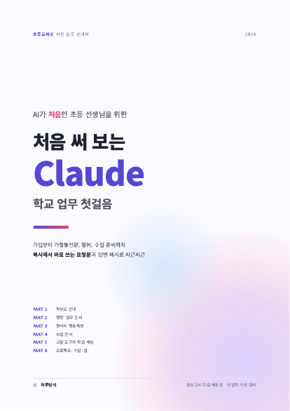

# 📘 처음 써 보는 Claude

**AI가 처음인 초등 선생님을 위한 Claude 학교 업무 첫걸음이에요.**
가입부터 가정통신문, 평어, 수업 준비까지 복사해서 바로 쓰는 요청문과 답변 예시로 차근차근 알려 줘요.

### [📱 웹페이지로 보기](https://berryst41.github.io/school/docs/claude-guide.html)

바뀐 점은 [아래 업데이트 기록](#업데이트-기록)에 있어요.

## 보는 방법

| 보는 방법 | |
|:---|:---|
| 📱 **[웹페이지로 보기](https://berryst41.github.io/school/docs/claude-guide.html)** | 핵심만 한 화면에 정리했어요. 요청문을 복사 단추로 바로 가져가요 |
| 🌐 **[PDF 바로 보기](https://berryst41.github.io/school/docs/claude-guide.pdf)** | 답변 예시까지 담긴 76쪽 원본이에요. 휴대폰·태블릿·컴퓨터 어디서나 열려요 |
| 🐙 **[깃허브 화면에서 보기](https://github.com/berryst41/school/blob/main/docs/claude-guide.pdf)** | 깃허브 안에서 쪽 넘기며 볼 수 있어요 |
| ⬇️ **[내려받기](https://github.com/berryst41/school/raw/main/docs/claude-guide.pdf)** | 파일로 저장해 두고 싶을 때 |

## 차례

| | 내용 |
|:---:|:---|
| PART 0 | 시작하기 전에 Claude와 친해지기 |
| PART 1 | 학부모 안내 · 가정통신문과 학급 소식 |
| PART 2 | 행정 · 업무 문서 기안부터 결과보고까지 |
| PART 3 | 성적 처리 시즌 평어와 행동특성 |
| PART 4 | 수업 준비 · 설계에서 학습지까지 |
| PART 5 | 교실 도구와 학습 게임 직접 만들기 |
| PART 6 | Claude 200% 쓰기 · 프로젝트·스킬·파일·앱 |
| PART 7 | 자잘하지만 확실한 꿀팁 100 |
| PART 8 | 안심하고 쓰는 체크리스트 |
| 부록 | 한 해 업무 달력과 한 줄 요청문 모음 |

## 업데이트 기록

| 날짜 | 바뀐 점 |
|:---:|:---|
| 2026-11-06 | 📱 웹페이지를 만들었어요. 요청문 104개를 복사 단추로 바로 가져가고, 장마다 PDF의 해당 쪽으로 넘어가요. |
| 2026-10-27 | 76쪽 PDF 안내서를 처음 올렸어요. |

 

🍓 [딸기농장으로 돌아가기](../../README.md)
